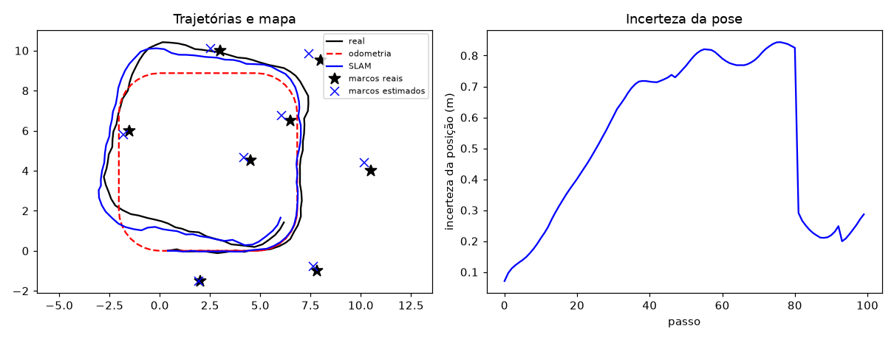

- **Disciplina:** Robótica Probabilística
- **Duração estimada:** 2 horas
- **Pré-requisitos:**
   - Aula de SLAM com Filtro de Kalman Estendido
   - Exercícios do Filtro de Kalman Estendido e da Localização de Markov e EKF concluídos

## Objetivos de aprendizagem

Ao final deste exercício, o aluno deve ser capaz de:

- Explicar o que é **SLAM**, como ele difere da localização e do mapeamento com poses conhecidas, e por que é difícil.
- Descrever o **estado combinado** do EKF SLAM, a **covariância cheia** e o que cada passo (**mover**, **observar**, **marco novo**, **corrigir**) faz com eles.
- Executar à mão um ciclo de **SLAM linear em uma dimensão** e verificar que **observar um marco** cria **correlações** e reduz a incerteza da pose **e** do mapa.
- **Interpretar** os resultados de uma simulação de EKF SLAM: o efeito do **fechamento de ciclo**, as **correlações**, a **associação de dados** (com *outliers* e marcos próximos), o **limiar** de Mahalanobis e o **custo** com o tamanho do mapa.

---

## Cenário

Um robô com rodas dá **100 passos** em um laço quadrado (de cerca de $9 \times 9$ m) e, depois, **volta a passar** pelo primeiro lado. O mapa é uma lista de **8 marcos** pontuais **desconhecidos pelo robô** (só o simulador e a avaliação conhecem as posições). O robô começa na origem, com **pose conhecida**: $x_0 = (0,\ 0,\ 0)^\top$, sem incerteza.

- **Movimento.** O controle é $u_t = (v_t,\ \omega_t)$, aplicado por $\Delta t = 1$ s. O modelo $g(u_t, \mu_{t-1})$, o seu Jacobiano $G_t$ e o ruído $R = \operatorname{diag}(0{,}05^2,\ 0{,}05^2,\ 0{,}02^2)$ são os da **Localização de Markov e EKF**.
- **Medição.** O sensor enxerga os marcos a até $4$ m e devolve a **distância** $r$ e a **direção** $\phi$. Com $\delta = (m_x - x,\ m_y - y)$ e $q = \delta^\top\delta$: $h(\mu, m) = (\sqrt{q},\ \operatorname{atan2}(\delta_y, \delta_x) - \theta)^\top$, com ruído $Q = \operatorname{diag}(0{,}10^2,\ 0{,}03^2)$.
- **Correspondência.** Quando é **conhecida**, cada medição vem com o índice $j$ do marco. Neste exercício a **assinatura** é esse índice e **não é estimada**: cada marco ocupa **2 números** ($x$, $y$) no estado, e não 3 como na aula (com $N$ marcos o estado tem $2N+3$ números).
- **Estado.** $\mu = (x,\ y,\ \theta,\ x_1,\ y_1,\ \dots,\ x_N,\ y_N)^\top$ e uma covariância $\Sigma$ de $(2N+3) \times (2N+3)$. O mapa **começa vazio** e cada marco entra quando é visto pela primeira vez.
- **Simulação.** O ruído do movimento **real** é o $R$ acima: sem as medições, o erro da pose **cresce** ao longo do percurso. Os resultados da Parte 3 vêm de uma simulação desse cenário, com o EKF SLAM implementado pelo professor.

---

## Parte 1 — Fundamentação teórica (sem calculadora)

1. **O problema.**
   a. O que é **SLAM**? Compare com a **localização** e com o **mapeamento com poses conhecidas**: o que é conhecido e o que é estimado em cada um?
   b. Explique o problema do **ovo e da galinha** nesse contexto.
   c. Diferencie o **SLAM online** do **SLAM completo**.

2. **Por que é difícil.**
   a. Que **duas partes** (uma contínua e uma discreta) tem o problema? O que é a **correspondência**?
   b. Por que o **posterior completo** é quase sempre inviável? Cite a dimensão e as correspondências.

3. **EKF SLAM: estado e covariância.**
   a. Por que o estado guarda **pose e mapa juntos**? Quantos números tem com $N$ marcos, na aula (3 por marco) e neste exercício?
   b. O que significam os blocos **fora da diagonal** da covariância? Por que ela é **cheia**?
   c. Qual é a **incerteza inicial** da pose e dos marcos? O que muda quando o número de marcos **não** é conhecido?

4. **Os passos do algoritmo.**
   a. **Mover:** o que muda no estado e na covariância, e o que **não** muda? Por que a incerteza da pose **cresce**?
   b. **Observar:** o que é a **inovação**?
   c. **Marco novo:** onde ele é inicializado? Por que isso importa para a linearização? Por que, com **câmeras** (só o ângulo), é preciso triangular?
   d. **Corrigir:** por que o ganho de Kalman é uma matriz **cheia**? Por que observar **um** marco melhora **todos os outros**?

5. **Ciclos, correlação e custo.**
   a. O que acontece com a incerteza da pose e do mapa quando o robô **revê o primeiro marco** depois de um longo percurso?
   b. Por que as estimativas dos marcos ficam **correlacionadas** com o tempo? O que o mapa passa a saber bem (relativo) e o que continua incerto (absoluto)?
   c. Por que memória e tempo crescem com $N^2$ e o que isso limita?

6. **Correspondências.**
   a. Descreva a associação por **máxima verossimilhança incremental**: o que é calculado, o que é a **distância de Mahalanobis** e quando se cria um marco novo.
   b. Para que servem a **lista provisória** e a **evidência de existência**?
   c. O que é a **confusão de marcos** e qual é o **compromisso** no número de marcos?

7. **Limites.** Cite três limitações do EKF SLAM (aula) e explique por que ele **não** serve para o SLAM **completo**.

---

## Parte 2 — Cálculo manual

### 2a — SLAM linear em uma dimensão

Um robô anda em uma **reta**, com pose $x$ (um número) e **um** marco $m$ (um número). O movimento é $x_t = x_{t-1} + u_t + \varepsilon_t$, com $\operatorname{Var}(\varepsilon_t) = R = 0{,}09$; a medição é $z_t = m - x_t + \delta_t$, com $\operatorname{Var}(\delta_t) = Q = 0{,}04$. Não há linearização ($H = (-1,\ +1)$). O robô começa em $x_0 = 0$ **exato**. A sequência é:

1. mede $z_1 = 4{,}9$ (primeira vez que o marco é visto);
2. move-se com $u_2 = 2{,}0$;
3. mede $z_3 = 3{,}1$.

Resolva, escrevendo $\mu$ e $\Sigma$ ($2 \times 2$) depois de cada passo:

1. **Passo 1 (marco novo):** $m = x + z_1$. Calcule $\mu$ e $\Sigma$. (Use $\Sigma_{mm} = \Sigma_{xx} + Q$ e $\Sigma_{xm} = \Sigma_{xx}$.)
2. **Passo 2 (mover):** quais elementos de $\Sigma$ mudam?
3. **Passo 3 (corrigir):** calcule a **inovação** $\nu = z_3 - (m - x)$, a covariância da inovação $S = H\Sigma H^\top + Q$, o **ganho** $K = \Sigma H^\top S^{-1}$ e a nova média e a nova covariância ($\mu \leftarrow \mu + K\nu$, $\Sigma \leftarrow \Sigma - K H \Sigma$).
4. **Interpretação:** (i) compare $\Sigma_{xx}$ e $\Sigma_{mm}$ antes e depois do passo 3; (ii) calcule a **correlação** $\rho = \Sigma_{xm}/\sqrt{\Sigma_{xx}\Sigma_{mm}}$ antes e depois; (iii) por que a **pose** foi puxada para **trás** e o **marco** para a frente?

### 2b — Associação por máxima verossimilhança

Com $\Sigma_{innov} = \operatorname{diag}(0{,}2^2,\ 0{,}04^2)$ (alcance e ângulo) para os dois marcos do mapa, uma medição produz estas **inovações** $\nu = (\nu_r,\ \nu_\phi)$:

| Marco | $\nu_r$ (m) | $\nu_\phi$ (rad) |
|---|:-:|:-:|
| A | $0{,}2$ | $0{,}02$ |
| B | $0{,}5$ | $0{,}10$ |

1. Calcule a distância de Mahalanobis ao quadrado $d^2 = \nu^\top \Sigma_{innov}^{-1} \nu$ para A e B. Com o limiar $\alpha = 9{,}21$ (99%, 2 g.l.), a que marco a medição é associada?
2. Em outra medição, as inovações são $(0{,}5;\ 0{,}09)$ para A e $(0{,}5;\ 0{,}10)$ para B. O que o algoritmo decide?
3. Se a medição **realmente** veio de um terceiro marco **muito próximo** de A, que problema aparece?

---

## Parte 3 — Interpretação de resultados

O professor executou o EKF SLAM neste cenário. Os números abaixo são **médias de 20 simulações** (sementes diferentes), salvo indicação. O mapa verdadeiro tem 8 marcos. A figura mostra **uma** simulação: à esquerda, a trajetória real, a da odometria e a do SLAM, e os marcos reais e os estimados; à direita, a **incerteza da posição** ($\sqrt{\Sigma_{xx} + \Sigma_{yy}}$) ao longo dos passos.

{width=100%}

**(0) A figura.** Em que trechos a incerteza da pose **cresce** e quando **cai**? Relacione com o que o robô vê.

**(a) SLAM × odometria.**

| | Erro médio de posição (m) | Erro final de posição (m) |
|---|:-:|:-:|
| Odometria | 0,86 | 1,27 |
| EKF SLAM | 0,42 | 0,28 |

O erro médio das posições estimadas dos marcos é $0{,}40$ m. Por que o SLAM é melhor que a odometria se o robô **não conhece o mapa**? Por que o erro **médio** do SLAM é maior que o **final**?

**(b) Fechar o ciclo.** No passo 81 o robô **revê o marco 0**, visto no começo (passo 12) com a pose exata (simulação da figura):

| | Incerteza antes (m) | Incerteza depois (m) |
|---|:-:|:-:|
| Pose | 0,825 | 0,291 |
| Marco 0 (visto agora) | 0,115 | 0,115 |
| Marco 3 (visto no passo 28 a 43) | 0,726 | 0,703 |
| Marco 5 (visto nos passos 56 a 77) | 0,722 | 0,535 |

O que acontece com a incerteza da **pose**? Qual marco **não visto** nesse passo mais se beneficia e por quê (pense nas **correlações**)?

**(c) Correlações** (mesma simulação, três voltas):

| Passo | $\lvert$correlação$\rvert$ média entre marcos | Incerteza média dos marcos (m) |
|:-:|:-:|:-:|
| 10 | 0,52 | 0,25 |
| 100 | 0,62 | 0,43 |
| 300 | 0,66 | 0,32 |

Como evoluem a correlação e a incerteza dos marcos? O que isso diz sobre o **mapa relativo**?

**(d) Associação de dados.** Com correspondência **conhecida** (o filtro recebe o índice do marco) ou por **máxima verossimilhança** (ML) com limiar de Mahalanobis:

| Caso | Marcos no mapa (verdade: 8) | Erro médio de posição (m) |
|---|:-:|:-:|
| Conhecida | 7,9 | 0,42 |
| ML, sem *outliers* | 9,4 | 0,42 |
| ML, 25% de *outliers* | 33,6 | 0,53 |

O que faz cada ***outlier*** quando a associação é por ML? Que ideia da aula (**lista provisória** ou **evidência de existência**) evitaria esses marcos falsos?

---

## Entregáveis

- Respostas da **Parte 1** e os cálculos e resultados da **Parte 2**.
- As respostas da **Parte 3** (0 e a a d).
